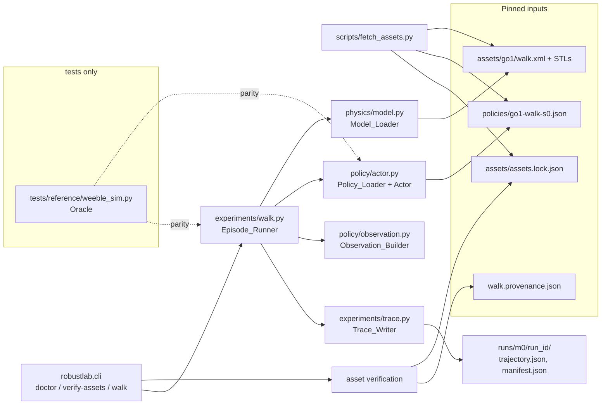

# Design Document: M0 — Pretrained Go1 walking in native MuJoCo

## Overview

M0 runs weeble's pretrained `go1-walk-s0` policy in native C MuJoCo 3.15.0 on a macOS CPU, records a
10 s trajectory and checks it against walking criteria fixed in advance. Everything is NumPy +
MuJoCo; there is no JAX, Brax, torch, CUDA or pickle.

Sources (pinned to one weeble commit, resolved in Task 1):

- Repository: <https://github.com/mottopanikeiku/weeble> (MIT).
- Policy `policies/go1-walk-s0.json`: base64 little-endian float32 MLP weights + normalizer, trained on
  Playground `Go1JoystickFlatTerrain` without shoves. Conventions documented in `policies/README.md`.
- Model `assets/go1/walk.xml` (Playground-derived, Apache-2.0) + `assets/go1/assets/{calf,hip,thigh,
  thigh_mirror,trunk}.stl` (Menagerie, BSD-3-Clause), with `assets/go1/walk.provenance.json` recording
  Playground commit `d59156e099a8785dd58fbce2e25a6ee1f7b5800c`, Menagerie commit
  `1b86ece576591213e2b666ebf59508454200ca97`, MuJoCo 3.15.0 and per-file SHA-256 (e.g. `walk.xml`
  `5f9e9cbae6732c9da3a6b6db9d6d48529ed7652d2c23ae5bda69f9191b7f162f`).
- Reference runner `eval/sim.py` (NumPy + MuJoCo only). Copied with its MIT notice to
  `tests/reference/weeble_sim.py` and used **only** as a test oracle.

Key design decisions:

| Decision | Rationale |
| --- | --- |
| weeble JSON policy over Playground ONNX fallback | JSON weights avoid pickle/ONNX runtime; exact-export XML + provenance hashes exist; oracle runner available |
| MuJoCo pinned to 3.15.0 (not tech.md's 3.17) | Matches the version the XML was exported/validated with; recorded in ADR |
| `src/robustlab/` layout | Follows `delivery.md` §7, which overrides `structure.md` for the deadline |
| Write our own runner, oracle in tests only | Clear provenance; parity tests prove convention fidelity |
| Criteria fixed before running | Prevents tuning thresholds to fit results |
| Upright check is provisional | `walk.xml` collides feet only, so non-foot contact cannot be observed in M0 |

## Architecture



Control-loop sequence for one Tick (`ctrl_dt` 0.02 s):

```mermaid
sequenceDiagram
  participant R as Episode_Runner
  participant Act as Actor
  participant MJ as MuJoCo
  participant Ob as Observation_Builder
  R->>Act: action = act(obs_t)
  R->>MJ: xfrc_applied = 0; ctrl = default_pose + 0.5*action
  R->>MJ: mj_step(model, data, nstep=5)
  R->>R: obs_last_action = last_action; last_action = action
  R->>Ob: obs_{t+1} = build(data, obs_last_action, command) (no mj_forward)
  R->>R: record time, qpos, qvel, action, command, contacts, up_z, trunk z
```

Dependency direction: `cli → experiments → {physics, policy}`; `trace` depends only on stdlib +
NumPy. Nothing in `src/` imports `tests/`.

## Components and Interfaces

### `scripts/fetch_assets.py`

- `fetch(commit: str, dest_root: Path) -> dict` — downloads the 9 pinned files from
  `https://raw.githubusercontent.com/mottopanikeiku/weeble/<commit>/<path>`, writes them, returns
  the lock dict. Writes `assets/assets.lock.json` atomically. Downloaded `walk.provenance.json` is
  stored alongside for verification.

### `robustlab.assets` (verification helpers, used by CLI and loaders)

- `sha256_file(path) -> str`
- `verify_assets(root: Path) -> list[AssetIssue]` — checks every lock entry exists and matches its
  SHA-256; checks XML/mesh hashes against `walk.provenance.json`. Empty list means pass.

### `robustlab.physics.model`

- `load_model(xml_path: Path) -> mujoco.MjModel`
- `apply_model_parameters(model, params: dict) -> None` — assigns listed arrays and `opt` fields;
  pure assignment, therefore idempotent.
- `resolve_ids(model) -> ResolvedIds` — trunk body, imu site, 4 foot geoms (`FR, FL, RR, RL` order
  from policy spec), floor geom; raises `ModelError` on missing names.
- `check_model(model, policy) -> None` — asserts `nq=19, nv=18, nu=12`, timestep 0.004,
  `n_substeps=5`, actuator order equals policy joint order.

### `robustlab.policy.actor`

- `load_policy(path: Path, expected_sha256: str) -> Policy` — validates schema_version 1, activation
  `swish|silu`, encoding `base64-f32-le`, chained layer shapes, `obs_dim=48`, `act_dim=12`, finite
  arrays, file hash; selects normalizer by `obs_key`. Raises `PolicyError(field, reason)`.
- `Actor(policy)` with `act(obs: np.ndarray[float32, 48]) -> np.ndarray[float32, 12]` — writes into
  preallocated buffers; normalization `(x-mean)/std`, no epsilon/clip; hidden `swish` using stable
  sigmoid (`exp(-|x|)` branch form); output `tanh(logits[:12])`.
- `swish(x, out) -> out` exposed for unit testing.

### `robustlab.policy.observation`

- `ObservationBuilder(model, ids, policy)` with `build(data, last_action, command, out) -> out` —
  fields in `policy.observation.fields` order: local_linvel (velocimeter sensor), gyro,
  gravity = `R_imu.T @ [0,0,-1]`, `qpos[7:] - default_pose`, `qvel[6:]`, delayed action, command.
  Never calls `mj_forward`.

### `robustlab.experiments.walk`

- `EpisodeConfig(command: tuple[float,float,float], seconds: float, seed: int)`
- `run_episode(model, policy, config) -> EpisodeRecord` — reset per conventions, loop Ticks, record
  per-Tick arrays (preallocated), collect MuJoCo warnings, time each Tick with `perf_counter_ns`.
- `evaluate(record, criteria: WalkCriteria) -> Outcome` — upright checks (45° gate, 60° recorded),
  trunk height, finiteness, warnings, forward speed 2–10 s in body frame, touchdowns and duty factor
  per foot, yaw drift, horizontal displacement.
- `latency_summary(tick_ns, warmup=50) -> dict` — median, p95, max, real-time factor.

### `robustlab.experiments.trace`

- `write_run(out_dir, record, manifest) -> RunPaths` — `trajectory.json` (50 Hz) and
  `manifest.json`; each via temp file + `os.replace`. Records JSON-write time.
- `read_run(out_dir) -> (trajectory, manifest)` for tests and checks.

### `robustlab.cli`

- `robustlab doctor` — Python/NumPy/MuJoCo versions, platform, `numpy.show_config()` BLAS info.
- `robustlab verify-assets` — prints per-file result, non-zero exit on any issue.
- `robustlab walk --policy PATH --command vx,vy,yaw --seconds S --out DIR [--seed N]` — verifies
  assets, runs, evaluates, writes run, prints summary table.

## Data Models

`assets/assets.lock.json`:

```json
{
  "schema_version": 1,
  "source": {"repo": "mottopanikeiku/weeble", "commit": "<40-hex>"},
  "files": [
    {"path": "assets/go1/walk.xml", "url": "https://raw.githubusercontent.com/...", "sha256": "5f9e9c..."}
  ]
}
```

Policy JSON fields consumed (read-only): `schema_version`, `activation`, `encoding`, `obs_key`,
`obs_dim`, `act_dim`, `layers[{shape, weight, bias}]`, `normalizer[obs_key]{mean, std}`,
`observation.fields`, `default_pose`, `default_qpos`, `default_qvel`, `action_scale` (0.5),
`ctrl_dt`, `sim_dt`, `n_substeps`, `joint_names`, `model_parameters`.

Internal (frozen dataclasses):

- `Policy{sha256, layers: list[(W float32, b float32)], mean, std, fields, default_pose, default_qpos,
  default_qvel, action_scale, joint_names, model_parameters}`
- `ResolvedIds{trunk_body, imu_site, foot_geoms[4], floor_geom, velocimeter_adr, gyro_adr}`
- `EpisodeRecord{time[T], qpos[T,19], qvel[T,18], action[T,12], command[T,3], contact[T,4] bool,
  up_z[T], trunk_z[T], warnings: dict, tick_ns[T]}`
- `WalkCriteria{tilt_deg=45, tilt_compare_deg=60, min_trunk_z=0.18, window=(2,10),
  min_forward_speed=0.7, min_touchdowns=5, zero_cmd_max_disp=0.3}` — fixed constants, written to the
  manifest.
- `Outcome{upright_45, upright_60, min_trunk_z, finite, warnings_ok, mean_forward_speed,
  distance, yaw_drift, touchdowns[4], duty_factor[4], horizontal_disp, first_violation_time,
  passed: bool, failed_checks: list[str]}`

`runs/m0/<run_id>/manifest.json` (schema_version 1): asset/policy hashes, weeble/Playground/Menagerie
commits, numpy/mujoco/python versions, platform, git revision (+dirty flag), `ctrl_dt`, `sim_dt`,
`n_substeps`, command, horizon, initial state, seed, criteria, outcomes, latency summary, load time.

`trajectory.json` (schema_version 1): `rate_hz: 50`, `time`, `qpos`, `qvel`, `action`, `command`,
`contact`, `up_z`, `trunk_z` as lists.

## Correctness Properties

*A property is a characteristic or behavior that should hold true across all valid executions of a system-essentially, a formal statement about what the system should do. Properties serve as the bridge between human-readable specifications and machine-verifiable correctness guarantees.*

Reflection: normalization and network-structure criteria (6.1, 6.2) are subsumed by oracle parity
(6.5); the four policy-rejection criteria (5.1–5.4) form one "malformed input" property; `xfrc`
clearing (7.6) folds into the Tick control invariant (7.5); the 60° record (10.2) folds into the
upright predicate (10.1). Closed-loop oracle parity (7.7), determinism (9.5) and the real walking
episodes (10.3–10.5 on the actual policy) are example/integration tests, not properties.

### Property 1: Tampered or missing assets are detected

For any pinned file in a temporary copy of the assets and any single-byte mutation or deletion of that
file, `verify_assets` reports an issue naming that file and `robustlab verify-assets` exits non-zero.

**Validates: Requirements 3.3, 3.4**

### Property 2: Applying model parameters is idempotent

For any starting values of the fields listed in the policy `model_parameters`, applying the parameters
twice yields model arrays and `opt` values equal to applying them once, and both equal the policy
values.

**Validates: Requirements 4.4, 4.5**

### Property 3: Malformed policies are rejected

For any valid policy document mutated by one of: a disallowed `schema_version`, activation or encoding;
a broken layer-shape chain; `obs_dim != 48` or `act_dim != 12`; a non-finite value at any position in
any weight, bias, mean or std array; or an expected SHA-256 that differs from the file, `load_policy`
raises `PolicyError` naming the offending field.

**Validates: Requirements 5.1, 5.2, 5.3, 5.4**

### Property 4: Swish is finite and accurate

For any float32 `x` in [-80, 80] (including both endpoints), `swish(x)` is finite and equals the
float64 reference `x / (1 + exp(-x))` within float32 rounding tolerance.

**Validates: Requirements 6.3**

### Property 5: Actor matches the Oracle

For any observation in a seeded set of 1,000 generated around the normalizer mean (mean ± 3·std), the
Actor's 12-dim action equals the Oracle's action within absolute tolerance 1e-7; the maximum absolute
error is recorded.

**Validates: Requirements 6.1, 6.2, 6.5**

### Property 6: Observation carries the delayed action

For any sequence of actions `a[0..N]` fed through the Episode_Runner by a stub actor, the action field
of observation `o[t+1]` equals `a[t-1]` for `t >= 1` and is zero for `t = 0`.

**Validates: Requirements 7.3**

### Property 7: Tick control invariant

For any action in [-1, 1]^12 and any pre-existing `xfrc_applied`, one Tick performs exactly 5 physics
substeps, `xfrc_applied` is zero during each substep, and `ctrl` equals `default_pose + 0.5 * action`
unchanged across all 5 substeps.

**Validates: Requirements 7.5, 7.6**

### Property 8: Trace serialization round trip

For any synthetic `EpisodeRecord` and manifest with finite float values, `write_run` followed by
`read_run` returns a trajectory and manifest equal to the written values, and no temporary files
remain in the output directory.

**Validates: Requirements 9.4, 9.6**

### Property 9: Upright predicate

For any recorded `up_z`, trunk height and state-finiteness arrays and warning counts (including values
exactly at `cos(45°)`, `cos(60°)`, 0.18 m and non-finite entries), `upright_45` is true if and only if
every Tick satisfies `up_z >= cos(45°)`, trunk height `>= 0.18`, finite state and zero warnings, and
`upright_60` is true if and only if every Tick satisfies `up_z >= cos(60°)`.

**Validates: Requirements 10.1, 10.2**

### Property 10: Forward speed is heading-invariant

For any synthetic straight-line trunk trajectory moving at constant body-frame forward speed `v` with
any constant yaw, the evaluator's mean body-frame forward speed over 2–10 s equals `v` within 1e-6.

**Validates: Requirements 10.3**

### Property 11: Touchdown counting

For any boolean foot-contact sequence, the touchdown count per foot over 2–10 s equals the number of
false→true transitions whose later Tick time lies in [2, 10] s.

**Validates: Requirements 10.4**

## Error Handling

| Condition | Behaviour |
| --- | --- |
| Asset missing or hash mismatch (lock or provenance) | `verify-assets` prints file + expected/actual hash, exit code 1; `walk` refuses to run |
| Policy validation failure | `PolicyError(field, reason)`; CLI prints it, exit code 2 |
| Model shape/ID/actuator-order mismatch | `ModelError`; CLI exit code 2 |
| Non-finite state or MuJoCo warning during an episode | Episode continues to horizon (no reset); first violation time recorded; `passed=false` with `failed_checks` |
| Walking criterion fails | Outcome and manifest report the failed checks; M0.md must not call the policy walking |
| Write failure | Temp file removed; previous files untouched; CLI exit code 3 |
| Network failure in `fetch_assets.py` | Abort without touching committed files or the lock |
| `mujoco.Renderer` raises any error on macOS | Rendering skipped, skip reason recorded in M0.md; no retry or workaround |

## Testing Strategy

- **Framework:** pytest. Markers: default (fast, CPU, < ~30 s total) and `integration` (10 s
  episodes, oracle closed-loop parity, latency benchmark).
- **Property tests:** the approved dev group is pytest + ruff only, so each property above is one
  pytest test driven by seeded NumPy generation with at least 100 cases (1,000 for Property 5),
  explicit boundary values, and the seed in the failure message. No shrinking is available; adding
  Hypothesis is deferred to M2 where `delivery.md` calls for property-based tests. Each test carries
  the tag comment `# Feature: m0-walking-go1, Property N: <title>`.
- **Example/unit tests:** model facts (nq/nv/nu, timestep, substeps, actuator order); reset
  observation (gravity ≈ [0,0,-1], zero joint offsets, zero action field); policy normalizer
  selection; preallocated buffers reused; manifest required keys; `latency_summary` on a known array;
  CLI smoke for `doctor`/`verify-assets`; subprocess check that `jax`, `brax`, `flax`, `torch` are absent
  from `sys.modules` after a short walk; `src/` does not import `tests`; `.kiro/` and `LICENSE`
  tracked by git and not matched by `git check-ignore`.
- **Integration tests (`-m integration`):** 500-Tick closed-loop parity with the Oracle (actions and
  qpos atol 1e-6); two identical runs give identical traces; Forward_Episode and Zero_Episode assert
  every walking criterion; latency benchmark (50 warm-up, ≥ 2,500 measured Ticks).
- **Not automated:** feasibility spike, network fetch, documentation review, optional PNG render.
